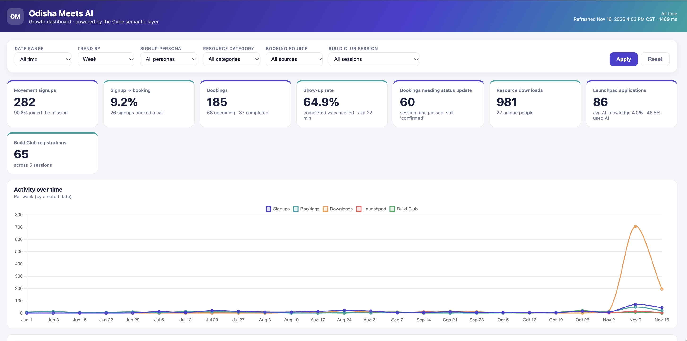
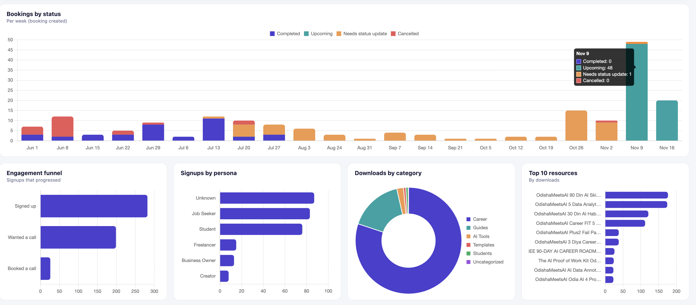

# Odisha Meets AI: governed metrics with Cube + a Java dashboard

A hands-on semantic layer project built on the real (anonymized) data of
Odisha Meets AI, a platform that helps students in Odisha learn AI in Odia.

**Supabase (Postgres) → PII-free views → Cube semantic layer → Spring Boot dashboard**



## Why

Every dashboard that writes its own SQL ends up with its own version of "conversion rate".
A semantic layer defines each metric **once** and every consumer (dashboards, notebooks, BI tools,
and next, an AI assistant) gets the same answer.

## Architecture

```
Supabase Postgres (raw tables, contain personal data)
  └── analytics.* views: no names, emails or phone numbers; emails hashed for unique counts
        └── role cube_reader: SELECT on analytics only (least privilege)
              └── Cube Core (Docker): model/cubes/*.yml = measures, dimensions, joins, views
                    ├── REST API :4000  ──►  Spring Boot dashboard :8080 (Java 21)
                    └── SQL API :15432 (Postgres wire protocol, for BI / JDBC)
```

## What's inside

| Path | What it is |
|---|---|
| `sql/01_analytics_schema.sql` | Governance layer: PII-free views + read-only role |
| `model/cubes/` | 7 cubes: signups, bookings, downloads, resources, Launchpad, Build Club sessions/registrations |
| `model/views/` | Curated consumer-facing views (`growth_funnel`, `content_engagement`) |
| `dashboard/` | Spring Boot app: predefined KPI/chart panels as Cube queries, filters, Chart.js UI |
| `docker-compose.yml` | Runs Cube + dashboard together |

### Metrics (defined once in Cube)
- **Growth:** signups, joined-mission %, signup → booking conversion %
- **Mentoring:** bookings, completed, upcoming, show-up rate (completed vs cancelled), avg duration
- **Data quality:** `needs_status_update`: sessions whose time has passed but are still "confirmed"
- **Content:** downloads, unique downloaders (via hashed key), downloads per person, by category/resource
- **Programs:** Launchpad applications, avg AI-knowledge rating, % who have used AI; Build Club registrations by session and referral source

### Dashboard
8 KPI tiles and 10 charts, with filters for date range (all / 30d / 90d / YTD / custom),
week or month trends, signup persona, resource category, booking source and Build Club session.
Filter state lives in the URL, so any view can be bookmarked.

Design choices:
- **No SQL and no metric math in Java.** `DashboardService` only names Cube measures, dimensions and filters.
- Panel queries run in parallel on Java 21 virtual threads.
- Short-lived HS256 JWTs signed with the Cube API secret, so it works with dev mode off.
- Handles Cube's `Continue wait` long-polling.



## Run it

Prerequisites: Docker, and a Postgres/Supabase database with the tables above.

```bash
# 1. Database: run sql/01_analytics_schema.sql, then set a password for cube_reader
# 2. Config
cp .env.example .env        # fill in host, user, password, API secret
# 3. Start
docker compose up --build
```
- Cube Playground: http://localhost:4000
- Dashboard: http://localhost:8080

## Production notes (intentionally not done here)
- `CUBEJS_DEV_MODE=false`, pinned Cube image version, provider CA certificate instead of skipping verification
- Pre-aggregations in Cube Store with `refresh_key` on `MAX(created_at)`
- Authentication in front of the dashboard; Cube security context for row-level rules
- CI: model validation + dashboard tests on every PR

## Roadmap
- [ ] Pre-aggregations and cache-hit monitoring
- [ ] Natural-language Q&A over the semantic layer (LLM picks governed metrics instead of writing SQL)
- [ ] Data-quality alerts (e.g. stale booking statuses)

## License
MIT. Built by Jayanta Kumar Rout.
